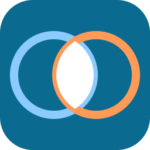
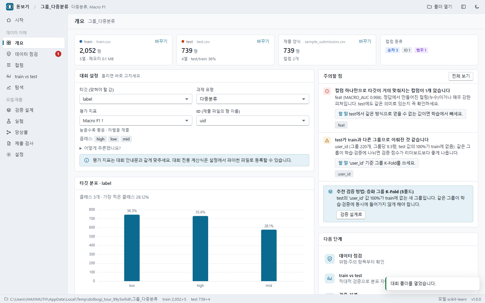
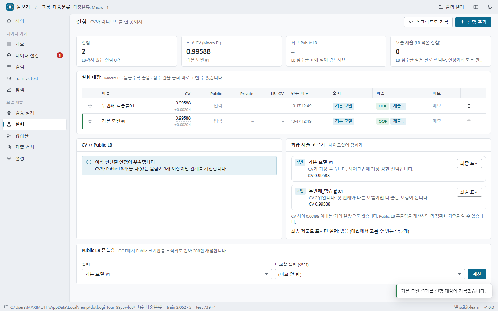

# 돋보기 (Dotbogi)

캐글·데이콘 **정형 데이터 대회**를 위한 로컬 분석 도구입니다.
데이터를 열자마자 함정(누수·분포 차이·검증 방법)을 찾고, 실험 점수와 리더보드를 한 곳에서 비교하고, 제출 파일은 올리기 전에 검사합니다.
모든 계산은 내 컴퓨터에서 하고, 데이터는 밖으로 나가지 않습니다.



## 무엇을 해주나요

| 화면 | 하는 일 |
|---|---|
| **개요** | train·test·제출 양식을 찾아 타깃·ID·과제 유형·평가 지표를 추론하고 이유를 보여줍니다. 틀리면 바로 고칩니다. |
| **데이터 점검** | 대회에서 자주 터지는 문제를 위험·주의·참고 순으로 정리합니다. 누수 의심 컬럼, train-test에 똑같은 행, 행 순서·ID 누수, 시간 분리, 그룹 구조, 새 범주, 숫자인데 문자인 컬럼, 공백만 다른 범주, 결측 비율 차이, 중복 행·ID, 타깃 불균형·치우침 등. |
| **컬럼** | 모든 컬럼의 train/test 분포를 겹쳐 그리고, 분포 차이(PSI·KS), 타깃과의 관계, 컬럼 하나로 타깃을 맞히는 정도(단일 피처 예측력)를 보여줍니다. 이진·다중분류·회귀 모두 됩니다. |
| **train vs test** | 적대적 검증: train과 test를 구분하는 모델로 두 데이터가 얼마나 다른지, 무엇이 둘을 가르는지 봅니다. 컬럼을 빼고 다시 돌릴 수 있고, 행마다 'test 같은 정도'를 파일로 저장합니다. |
| **탐색** | 예측력 순위, 상관 행렬, 그래프 만들기(분포·산점도·상자·교차표), 원본 데이터 보기(정렬·필터). |
| **검증 설계** | 데이터 구조를 보고 K-Fold·층화·그룹·시간 검증 중 무엇을 쓸지 이유와 함께 추천하고, 학습 코드에서 그대로 쓰는 `folds.csv`를 만듭니다. 기본 모델(LightGBM, 없으면 scikit-learn)로 기준 점수를 냅니다. |
| **실험** | CV·Public LB·Private LB·메모를 한 표에서 기록·비교합니다. CV와 LB가 같이 움직이는지 판정하고, **Public LB 점수 차이가 우연인지**(OOF로 시뮬레이션) 알려주고, 최종 제출 2개를 추천합니다. 오늘 제출 횟수, 데이콘 최종 선택 주의도 안내합니다. |
| **앙상블** | OOF가 있는 실험들로 힐클라이밍 가중치를 찾고, 가중치를 다른 폴드로 검증한 **정직한 점수**를 같이 보여줘 과적합을 드러냅니다. 저장하면 제출 파일까지 만듭니다. |
| **제출 검사** | sample_submission과 비교해 컬럼·순서·행 수·ID(중복·누락·앞자리 0)·빈 값·확률/라벨 혼동·값 범위·인코딩을 검사하고, 의미를 바꾸지 않는 것만 고친 파일을 따로 저장합니다. 두 제출의 차이도 봅니다. |
| **보고서** | 분석 결과를 HTML 파일 하나로 저장합니다. 원본 데이터는 넣지 않아 가볍고 인터넷 없이 열립니다. |

### 기존 도구와 무엇이 다른가요

조사 내용과 근거는 [기획서](docs/PLAN.md)와 [조사 자료](docs/research/)에 있습니다. 요약하면:

- Sweetviz·ydata-profiling은 범주형·다중분류 타깃을 다루지 못하고, 큰 데이터에서 HTML이 무거워집니다. 돋보기는 모든 과제 유형을 다루고, 결과는 요약만 담습니다.
- Deepchecks·nyaggle 같은 검증 도구는 유지보수가 멈췄거나(2023~2024) 최신 pandas·Python과 맞지 않습니다. 돋보기는 pandas 2·3, Python 3.10 이상에서 동작합니다.
- MLflow·W&B 같은 실험 추적 도구에는 리더보드 개념이 없어 참가자들이 시트에 손으로 적습니다. 돋보기는 CV와 LB를 같이 다룹니다.
- 제출 파일을 올리기 전에 검사해 주는 도구는 찾지 못했습니다.
- 한국어 화면이고, 한글 컬럼명·cp949 CSV를 그대로 엽니다.

## 설치

Python 3.10 이상이 필요합니다.

```bash
# 이 폴더에서
pip install -e .[lightgbm]
# 또는 설치 파일로
pip install dist/dotbogi-1.0.0-py3-none-any.whl
pip install lightgbm        # 선택: 있으면 더 빠르고 중요도가 정확합니다
```

필수 의존성은 pandas, numpy, scipy, scikit-learn, pyarrow뿐입니다. 캐글·코랩 노트북에는 모두 기본으로 들어 있습니다.

## 실행

```bash
dotbogi                                  # 시작 화면 (최근 연 대회 목록)
dotbogi C:\Projects\Dacon\대회이름        # 바로 그 대회를 열기
python -m dotbogi                        # dotbogi 명령이 없을 때
```

주소창 없는 독립 창(데스크톱 앱 창)으로 열립니다. 설치된 Edge나 Chrome의 앱 창 기능을 쓰고, 돋보기 전용 프로필을 따로 씁니다. **창을 닫으면 돋보기도 끝납니다.**
Edge·Chrome이 없으면 기본 브라우저 탭으로 열고, 이때는 터미널에서 Ctrl+C로 끝냅니다.

```bash
dotbogi --browser                        # 독립 창 대신 기본 브라우저 탭으로
dotbogi --no-browser                     # 서버만 켜기 (주소: http://127.0.0.1:8765/)
dotbogi shortcut                         # 바탕화면에 돋보기 아이콘 바로가기 만들기 (Windows)
dotbogi shortcut C:\Projects\Dacon\대회이름  # 그 대회를 바로 여는 바로가기
```

바로가기는 콘솔 창 없이 앱만 띄웁니다. 윈도우에서는 `run_dotbogi.bat`을 두 번 눌러도 됩니다.

화면은 데스크톱 프로그램처럼 생겼습니다. 위에 제목 표시줄(지금 연 대회, 폴더 열기, 메뉴 접기, 테마), 왼쪽에 메뉴, 아래에 상태 표시줄(폴더, 데이터 크기, 진행 중인 작업)이 있습니다.

| 단축키 | 하는 일 |
|---|---|
| Ctrl+O | 대회 폴더 열기 |
| Ctrl+1 ~ 0 | 왼쪽 메뉴 순서대로 화면 이동 |
| Ctrl+B | 메뉴 접기·펴기 |
| Esc | 대화 상자 닫기 |

### 처음 쓰는 순서

1. **시작**에서 train·test·sample_submission이 든 폴더를 엽니다.
2. **개요**에서 타깃·과제·평가 지표가 대회 안내와 같은지 확인합니다. 다르면 바로 고칩니다.
3. **데이터 점검**의 위험·주의 항목부터 봅니다.
4. **train vs test**에서 적대적 검증을 돌려 두 데이터가 같은 방식으로 뽑혔는지 봅니다.
5. **검증 설계**에서 추천대로 폴드를 만들고 기본 모델로 기준 점수를 냅니다.
6. 학습 스크립트에서 `dotbogi.log(...)`로 실험을 기록하고, 제출 후 **실험**에서 Public LB를 적어 넣습니다.
7. 마감 전에 **실험**의 최종 제출 추천과 **제출 검사**를 확인합니다.



## 학습 스크립트와 함께 쓰기

```python
import dotbogi

folds = dotbogi.folds(r"C:\Projects\Dacon\대회")    # 화면에서 만든 폴드 (train 행 순서, 안 쓰는 행은 -1)

# ... 폴드별로 학습해서 oof(train 행 순서 예측)와 test_pred(test 행 순서 예측)를 만든 뒤
dotbogi.log(
    r"C:\Projects\Dacon\대회",
    name="lgbm_v3",
    oof=oof,               # 이진분류: 양성 확률, 다중분류: (행, 클래스) 확률, 회귀: 값
    test_pred=test_pred,   # 넣으면 sample_submission 모양의 제출 파일도 만들어 둡니다
    params=params, notes="피처 12개 추가",
)                          # cv를 생략하면 설정된 지표로 OOF에서 계산합니다
```

기록한 실험은 화면의 실험 대장에 바로 나타나고, OOF가 있으면 앙상블과 LB 흔들림 계산에 쓸 수 있습니다.
다른 곳에서 만든 OOF·제출 파일은 **실험 → 실험 추가**로 넣을 수 있습니다(ID 컬럼이 있으면 ID로 행을 맞춥니다).

## 명령줄 (스크립트·AI 에이전트용)

```bash
dotbogi check 대회폴더 [--json]                  # 데이터 점검 (위험 항목이 있으면 종료 코드 2)
dotbogi sub-check 제출.csv -p 대회폴더 [--fix]    # 제출 파일 검사 (문제가 있으면 종료 코드 1)
dotbogi report 대회폴더 -o report.html [--adversarial]
```

학습 파이프라인 마지막에 `dotbogi sub-check`를 넣으면 잘못된 파일을 올리기 전에 막을 수 있습니다.

## 노트북(캐글·코랩)에서

인터넷이 막힌 캐글 노트북이라면 설치 파일(`.whl`)을 데이터셋으로 올린 뒤 `pip install --no-deps`로 설치하세요.

```python
import dotbogi
dotbogi.report("/kaggle/input/대회이름", "/kaggle/working/report.html", adversarial=True)
```

노트북 셀 안에 보고서가 바로 뜹니다. 입력 폴더가 읽기 전용이면 기록은 사용자 홈의 `.dotbogi/projects/` 아래에 저장됩니다.

## 그 밖의 기능

- **Kaggle 제출 기록 가져오기**: 설정에 대회 주소를 적고, Kaggle 공식 CLI(`pip install kaggle`, API 토큰 설정)가 있으면 실험 화면의 버튼으로 제출별 Public/Private 점수를 가져옵니다. 돋보기에서 내려받은 제출 파일은 파일 이름에 실험 ID가 들어 있어 자동으로 짝이 맞춰집니다.
- **대회 전용 평가식**: 설정에서 `score(y_true, y_pred)` 함수가 든 파이썬 파일을 등록하면 CV·앙상블·LB 흔들림 계산에 그 식을 씁니다. 데이콘의 복합 지표(예: AUC와 Brier 조합)를 그대로 옮길 수 있습니다. Brier·ECE는 기본 지표에도 있습니다.
- **대회 정보**: 플랫폼, Public LB 비율, 하루 제출 한도, 최종 선택 수, 마감일(사이드바에 D-day), 규칙 메모.
- **밝은·어두운 테마**: 사이드바 아래 버튼.

## 저장되는 것

대회 폴더 안 `.dotbogi/` 폴더에 모입니다. 폴더째 옮기거나 지워도 원본 데이터는 그대로입니다.

```
.dotbogi/
  project.json          설정 (타깃, 지표, 직접 바꾼 컬럼 종류, 대회 정보)
  folds.csv             폴드 번호
  experiments.json      실험 대장
  runs/<실험ID>/        oof.parquet, test.parquet, submission.csv
  trash/                삭제한 실험 (되살릴 수 있게)
  cache/                큰 CSV의 parquet 사본, 컬럼 분석 결과
  test_likeness.csv     적대적 검증의 행별 'test 같은 정도'
  report-*.html         보고서
```

## 데이터와 보안

- 서버는 `127.0.0.1`에만 열리고, 실행할 때마다 만드는 토큰이 없으면 API를 쓸 수 없습니다. 다른 웹사이트가 이 서버를 부를 수 없습니다.
- 인터넷 연결이 필요 없습니다. 차트 라이브러리(Apache ECharts)도 패키지에 들어 있습니다.
- Kaggle 기록 가져오기만 Kaggle 공식 CLI를 실행합니다. 인증 정보는 돋보기가 읽거나 저장하지 않습니다.

## 문제 해결

- **포트가 이미 쓰는 중**: 다음 번호로 자동으로 엽니다. 직접 정하려면 `dotbogi --port 9000`.
- **한글이 깨진 CSV**: utf-8·cp949를 자동으로 판별합니다. 그래도 깨지면 파일을 utf-8로 다시 저장하세요.
- **메모리 부족**: 적대적 검증은 train·test 각 10만 행 표본, 단일 피처 예측력은 최대 100만 행 표본을 씁니다. 그래도 부족하면 다른 프로그램을 닫고 다시 해 보세요.
- **화면이 이상할 때**: 브라우저를 새로고침하세요. 계산 결과는 `.dotbogi/cache`에 있어 다시 계산하지 않습니다.

## 개발

```bash
pip install -e .[all,dev]
pytest                                   # 단위·통합 테스트
pip install playwright                   # 화면 자동 점검 (설치된 Edge 사용)
python tests/ui_tour.py 캡처폴더 msedge   # 모든 화면·창을 눌러 보고 캡처, 콘솔 오류가 있으면 실패
```

구조는 단순합니다. `dotbogi/analysis/`가 계산, `api.py`가 화면용 기능, `server.py`가 표준 라이브러리 HTTP 서버, `static/`이 빌드 없는 화면(바닐라 JS + ECharts)입니다.

## 라이선스

MIT. 포함된 Apache ECharts 6.1.0은 Apache License 2.0을 따릅니다(`dotbogi/static/vendor/ECHARTS_LICENSE.txt`).
