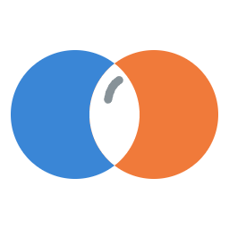
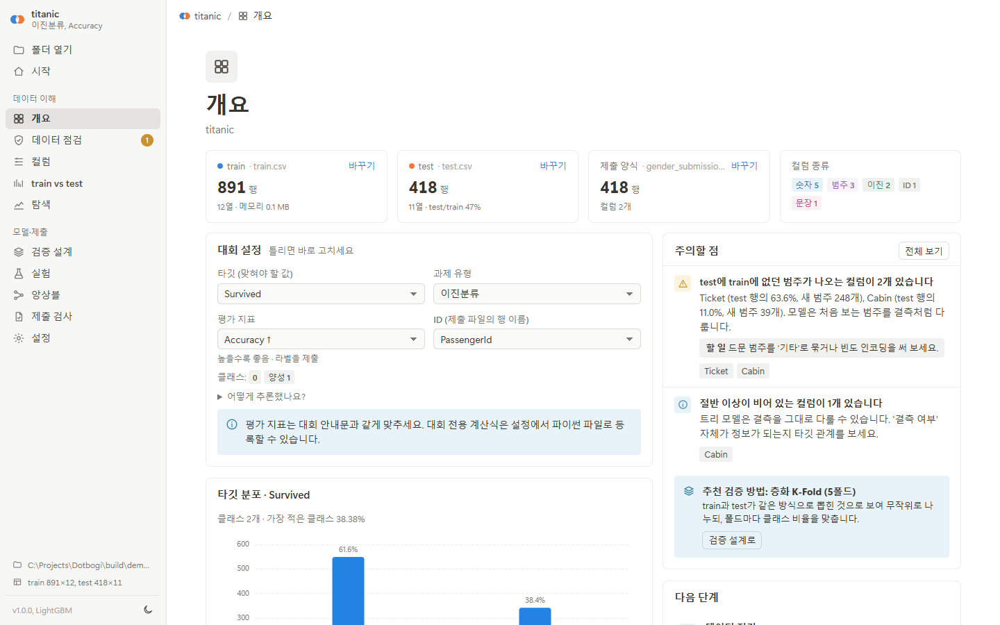
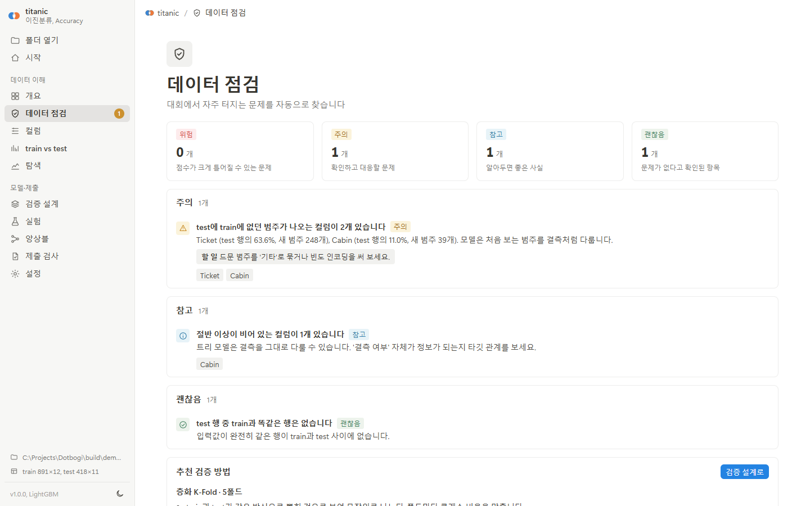
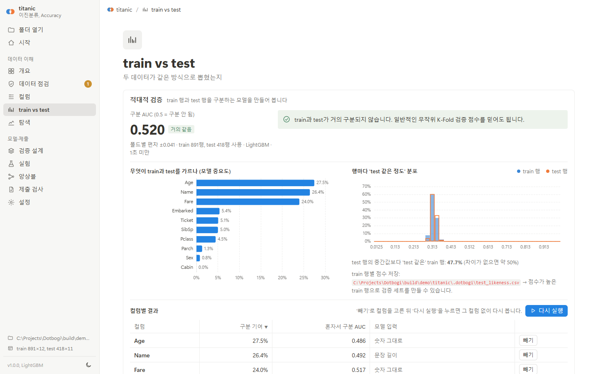
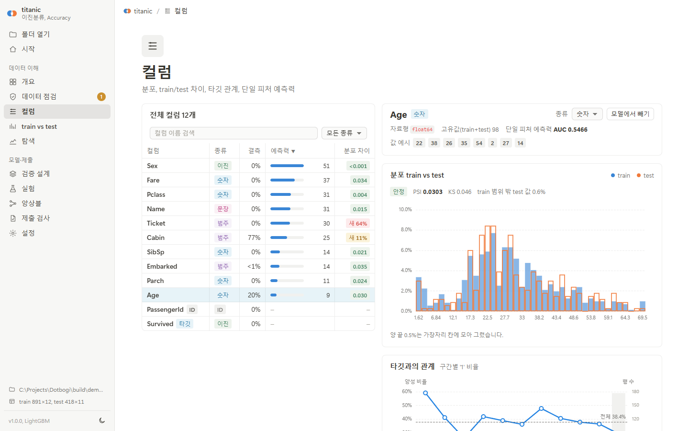
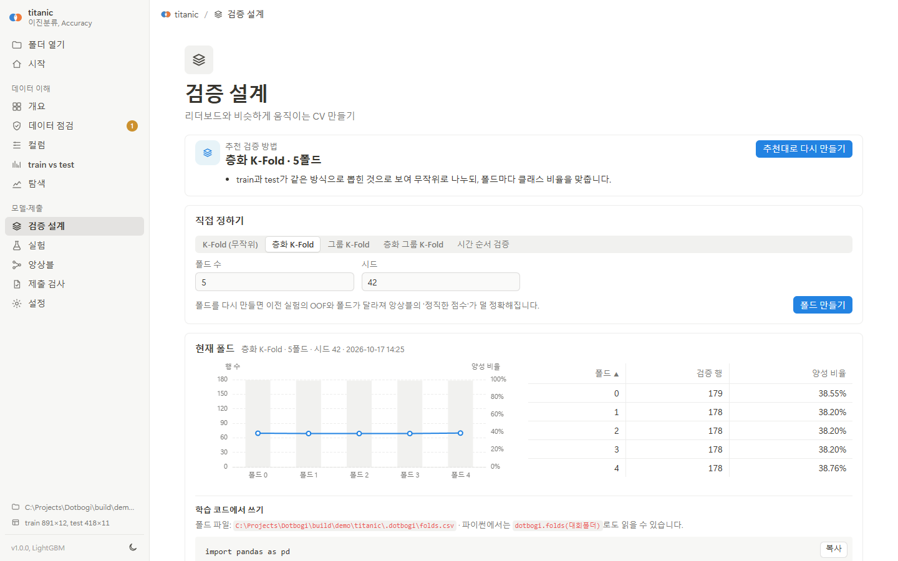
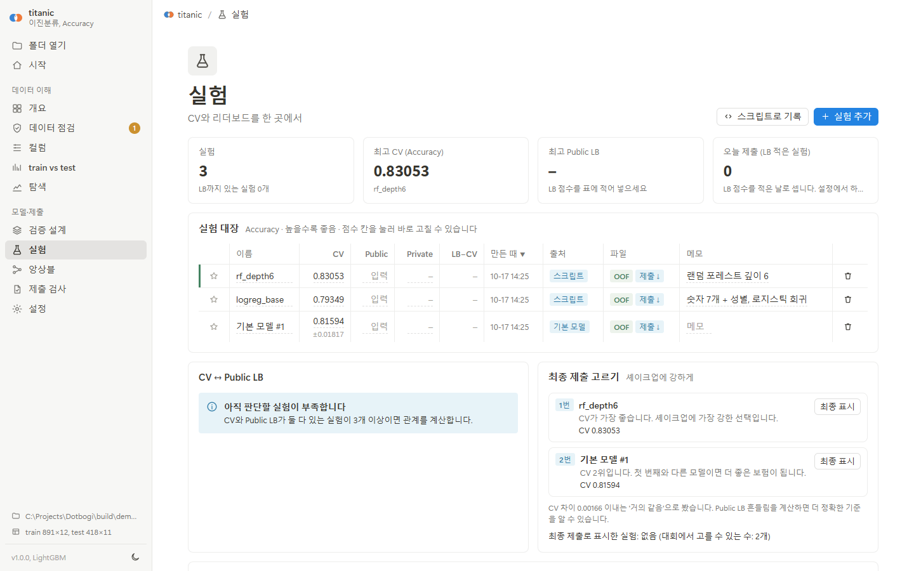
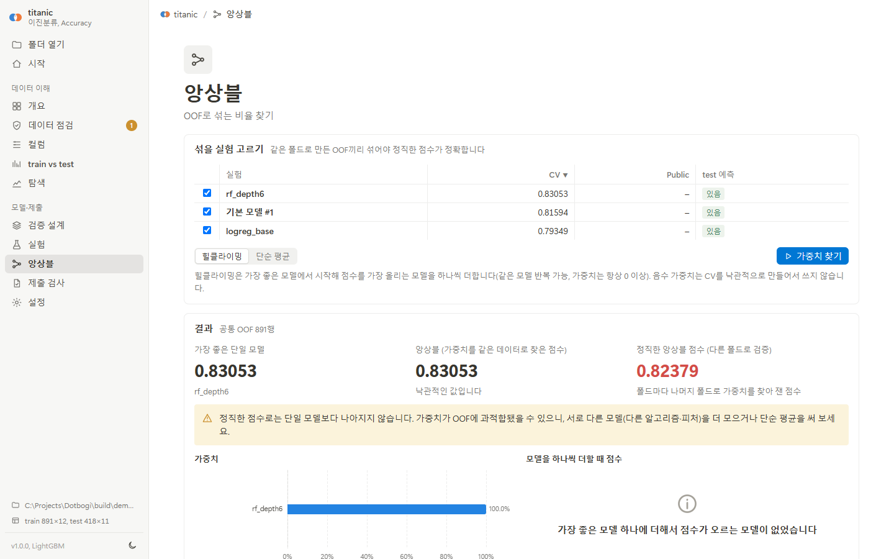
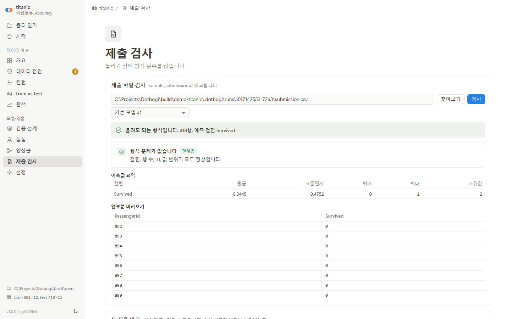
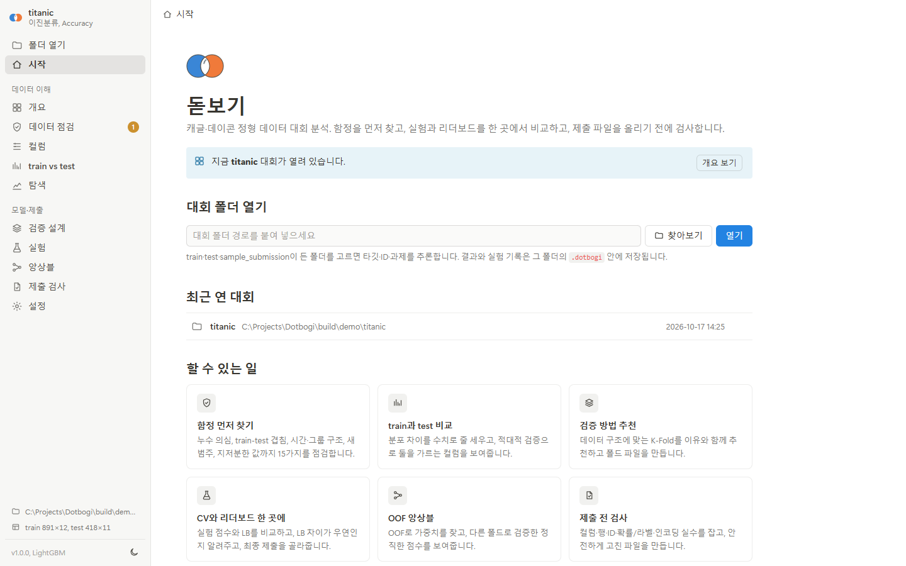

<div align="center">



# 돋보기

**캐글·데이콘 정형 데이터 대회를 위한 데스크톱 분석 도구**

데이터를 열자마자 함정을 찾고, CV와 리더보드를 한 곳에서 비교하고,<br>
제출 파일은 올리기 전에 검사합니다. 모든 계산은 내 컴퓨터 안에서 끝납니다.

[](#파이썬-패키지)
[](#데스크톱-앱-windows)
[](#데이터와-보안)
[](LICENSE)

[대회 흐름](#대회-흐름) · [화면](#화면) · [설치](#설치) · [학습 스크립트와 함께](#학습-스크립트와-함께-쓰기) · [명령줄](#명령줄)

</div>

<br>

<picture>
  <source media="(prefers-color-scheme: dark)" srcset="assets/overview-dark.png">
  
</picture>

## 대회 흐름

대회 폴더 하나를 열면, 참가자가 마감까지 묻게 되는 질문을 순서대로 화면 하나씩이 맡습니다.

| | 묻는 질문과 화면 | 돋보기가 하는 일 |
|:-:|---|---|
| 1 | 타깃·ID·평가 지표를 제대로 잡았나?<br>**개요** | train·test·제출 양식을 찾아 과제와 지표를 추론하고, 이유를 보여 줍니다. 틀리면 그 자리에서 고칩니다. |
| 2 | 모르고 지나치면 리더보드에서 터질 함정은?<br>**데이터 점검** | 누수 의심 컬럼, train-test 중복 행, 행 순서·ID 누수, 시간·그룹 구조, 새 범주, 지저분한 값 등 15가지를 위험·주의·참고 순으로 정리합니다. |
| 3 | train과 test는 같은 방식으로 뽑혔나?<br>**train vs test** | 적대적 검증으로 둘이 얼마나 다른지, 무엇이 둘을 가르는지 보여 줍니다. 컬럼을 빼고 다시 돌릴 수 있습니다. |
| 4 | 어떤 검증을 해야 LB와 같이 움직이나?<br>**검증 설계** | K-Fold·층화·그룹·시간 검증 중 맞는 것을 이유와 함께 추천하고, 학습 코드에서 그대로 쓰는 `folds.csv`와 기준 점수를 만듭니다. |
| 5 | 이 LB 차이는 실력인가, 운인가?<br>**실험** | CV·Public·Private LB를 한 표에 모으고, OOF로 Public LB 흔들림을 시뮬레이션해 두 실험의 차이가 우연인지 알려 줍니다. 최종 제출 2개도 추천합니다. |
| 6 | 섞으면 정말 좋아지나, 과적합인가?<br>**앙상블** | OOF 힐클라이밍 가중치와 함께, 가중치를 다른 폴드로 검증한 **정직한 점수**를 보여 줍니다. |
| 7 | 이 파일, 올려도 되나?<br>**제출 검사** | 컬럼·순서·행 수·ID(중복·누락·앞자리 0)·확률/라벨 혼동·인코딩을 검사하고, 의미를 바꾸지 않는 것만 고친 파일을 따로 만듭니다. |

이 밖에 **컬럼**(모든 컬럼의 train/test 분포, 타깃 관계, 단일 피처 예측력), **탐색**(상관 행렬, 그래프 만들기, 원본 데이터 보기), **보고서**(분석 결과를 HTML 파일 하나로)가 있습니다.

## 화면

<table>
  <tr>
    <td width="50%"><br><b>데이터 점검</b> · 대회에서 자주 터지는 문제를 위험도 순으로, 할 일과 함께</td>
    <td width="50%"><br><b>train vs test</b> · 적대적 검증 AUC, 둘을 가르는 컬럼, 행마다 'test 같은 정도'</td>
  </tr>
  <tr>
    <td><br><b>컬럼</b> · train과 test 분포를 겹쳐 보고, 분포 차이와 타깃 관계를 한눈에</td>
    <td><br><b>검증 설계</b> · 데이터 구조에 맞는 검증 추천, 폴드 파일, 기본 모델 기준 점수</td>
  </tr>
  <tr>
    <td><br><b>실험</b> · CV와 LB를 한 표에서, LB 차이가 우연인지, 최종 제출 추천</td>
    <td><br><b>앙상블</b> · 힐클라이밍 가중치와 다른 폴드로 검증한 정직한 점수</td>
  </tr>
  <tr>
    <td><br><b>제출 검사</b> · 올리기 전에 형식 실수를 잡고, 안전하게 고친 파일을 따로</td>
    <td><br><b>시작</b> · 대회 폴더를 열고, 최근 연 대회로 바로 돌아가기</td>
  </tr>
</table>

<sub>스크린샷은 캐글 Titanic 데이터로 찍었습니다. 실험 세 개는 화면의 기본 모델과, 학습 스크립트에서 `dotbogi.log`로 기록한 두 모델입니다.</sub>

## 기존 도구와 다른 점

| 기존 도구에서 겪는 불편 | 돋보기 |
|---|---|
| Sweetviz·ydata-profiling은 범주형·다중분류 타깃을 다루지 못하고, 큰 데이터에서 HTML이 무거워집니다. | 이진·다중분류·회귀 모두 다루고, 결과는 요약만 담아 가볍습니다. |
| 고유값 많은 컬럼이 타깃을 외워 관계가 부풀려 보입니다. | 단일 피처 예측력을 다른 폴드로 잽니다(OOF 타깃 인코딩). |
| Deepchecks·nyaggle은 유지보수가 멈췄거나 최신 pandas·Python과 맞지 않습니다. | pandas 2·3, Python 3.10 이상에서 동작합니다. |
| MLflow·W&B에는 리더보드 개념이 없어 시트에 손으로 적습니다. | CV와 Public·Private LB를 같은 표에서 다루고, 스크립트 한 줄로 기록합니다. |
| 힐클라이밍 앙상블은 같은 OOF로 점수를 매겨 과적합을 숨깁니다. | 가중치를 다른 폴드로 검증한 점수를 같이 보여 줍니다. |
| 제출 파일을 올리기 전에 검사해 주는 도구가 없습니다. | 제출 검사와 의미를 바꾸지 않는 자동 수정이 있습니다. |
| 한국어 화면이 없고 한글 CSV가 깨집니다. | 한국어 화면, 한글 컬럼명, cp949 CSV를 그대로 엽니다. |

## 설치

### 데스크톱 앱 (Windows)

설치 파일 `Dotbogi-Setup-1.0.0.exe`를 실행하면 끝입니다. 파이썬이 필요 없고, 관리자 권한 없이 사용자 폴더에 설치되며, 시작 메뉴에 **돋보기**가 생깁니다.
제거는 Windows 설정의 '앱'에서 합니다. 대회 폴더의 `.dotbogi` 기록은 지우지 않습니다.

- 자체 창으로 뜹니다. 노션 데스크톱 앱처럼 제목 표시줄 없이 위쪽 줄을 끌어 옮기고, 두 번 누르면 최대화합니다.
- 폴더 고르기와 파일 저장은 Windows 기본 창을 씁니다.
- 창과 분석 엔진이 서로 다른 프로세스라, 무거운 분석 중에도 창이 멈추지 않습니다. 창을 닫으면 둘 다 끝납니다.

<details>
<summary><b>설치 파일 직접 만들기</b></summary>

<br>

[Inno Setup 6](https://jrsoftware.org/isinfo.php)이 필요합니다 (`winget install JRSoftware.InnoSetup`).

```bash
pip install -e .[all] pyinstaller
python packaging/build.py          # dist/Dotbogi/Dotbogi.exe 와 dist/Dotbogi-Setup-1.0.0.exe
```

빌드는 묶은 exe가 LightGBM·scikit-learn·parquet를 제대로 쓰는지 스스로 점검한 뒤에 설치 파일을 만듭니다 (`Dotbogi.exe --selftest`).

</details>

### 파이썬 패키지

Python 3.10 이상, Windows·macOS·Linux.

```bash
pip install -e .[all]       # LightGBM, 엑셀, 데스크톱 창(pywebview)까지
pip install -e .            # 최소 설치: pandas, numpy, scipy, scikit-learn, pyarrow
```

필수 의존성은 캐글·코랩 노트북에 모두 기본으로 들어 있는 것들뿐입니다.

```bash
dotbogi                                     # 시작 화면 (최근 연 대회 목록)
dotbogi C:\Projects\Dacon\대회이름           # 바로 그 대회를 열기
dotbogi --browser                           # 자체 창 대신 브라우저로
dotbogi shortcut                            # 바탕화면에 돋보기 바로가기 (Windows)
```

pywebview가 없으면 Edge/Chrome 앱 창이나 기본 브라우저 탭으로 엽니다.

### 단축키

| 키 | 하는 일 |
|---|---|
| <kbd>Ctrl</kbd>+<kbd>O</kbd> | 대회 폴더 열기 |
| <kbd>Ctrl</kbd>+<kbd>1</kbd> ~ <kbd>0</kbd> | 왼쪽 메뉴 순서대로 화면 이동 |
| <kbd>Ctrl</kbd>+<kbd>B</kbd> | 사이드바 닫기·열기 |
| <kbd>Esc</kbd> | 대화 상자 닫기 |

## 학습 스크립트와 함께 쓰기

화면에서 만든 폴드로 학습하고, 결과를 한 줄로 실험 대장에 남깁니다.

```python
import dotbogi

folds = dotbogi.folds(r"C:\Projects\Dacon\대회")    # train 행 순서의 폴드 번호 (안 쓰는 행은 -1)

# ... 폴드별로 학습해서 oof(train 행 순서 예측)와 test_pred(test 행 순서 예측)를 만든 뒤
dotbogi.log(
    r"C:\Projects\Dacon\대회",
    name="lgbm_v3",
    oof=oof,               # 이진분류: 양성 확률, 다중분류: (행, 클래스) 확률, 회귀: 값
    test_pred=test_pred,   # 넣으면 sample_submission 모양의 제출 파일도 만들어 둡니다
    params=params, notes="피처 12개 추가",
)                          # cv를 생략하면 설정된 지표로 OOF에서 계산합니다
```

기록한 실험은 화면의 실험 대장에 바로 나타나고, OOF가 있으면 앙상블과 LB 흔들림 계산에 쓰입니다.
다른 곳에서 만든 OOF·제출 파일은 **실험 → 실험 추가**로 넣을 수 있습니다(ID 컬럼이 있으면 ID로 행을 맞춥니다).

## 명령줄

스크립트와 AI 에이전트를 위해 화면과 같은 기록을 쓰는 명령이 있습니다.

```bash
dotbogi check 대회폴더 [--json]                  # 데이터 점검 (위험 항목이 있으면 종료 코드 2)
dotbogi sub-check 제출.csv -p 대회폴더 [--fix]    # 제출 파일 검사 (문제가 있으면 종료 코드 1)
dotbogi report 대회폴더 -o report.html [--adversarial]
```

학습 파이프라인 마지막에 `dotbogi sub-check`를 넣으면 잘못된 파일을 올리기 전에 막을 수 있습니다.

<details>
<summary><b>노트북(캐글·코랩)에서</b></summary>

<br>

인터넷이 막힌 캐글 노트북이라면 설치 파일(`.whl`)을 데이터셋으로 올린 뒤 `pip install --no-deps`로 설치하세요.

```python
import dotbogi
dotbogi.report("/kaggle/input/대회이름", "/kaggle/working/report.html", adversarial=True)
```

노트북 셀 안에 보고서가 바로 뜹니다. 입력 폴더가 읽기 전용이면 기록은 사용자 홈의 `.dotbogi/projects/` 아래에 저장됩니다.

</details>

<details>
<summary><b>그 밖의 기능</b></summary>

<br>

- **Kaggle 제출 기록 가져오기**: 설정에 대회 주소를 적고, Kaggle 공식 CLI(`pip install kaggle`, API 토큰 설정)가 있으면 실험 화면의 버튼으로 제출별 Public/Private 점수를 가져옵니다. 돋보기에서 내려받은 제출 파일은 파일 이름에 실험 ID가 들어 있어 자동으로 짝이 맞춰집니다.
- **대회 전용 평가식**: 설정에서 `score(y_true, y_pred)` 함수가 든 파이썬 파일을 등록하면 CV·앙상블·LB 흔들림 계산에 그 식을 씁니다. 데이콘의 복합 지표(예: AUC와 Brier 조합)를 그대로 옮길 수 있습니다.
- **대회 정보**: 플랫폼, Public LB 비율, 하루 제출 한도, 최종 선택 수, 마감일(사이드바에 D-day), 규칙 메모.
- **밝은·어두운 테마**: 사이드바 아래 버튼. 처음에는 시스템 설정을 따릅니다.

</details>

<details>
<summary><b>저장되는 것</b></summary>

<br>

대회 폴더 안 `.dotbogi/` 폴더에 모입니다. 폴더째 옮기거나 지워도 원본 데이터는 그대로입니다.

```
.dotbogi/
  project.json          설정 (타깃, 지표, 직접 바꾼 컬럼 종류, 대회 정보)
  folds.csv             폴드 번호
  experiments.json      실험 대장
  runs/<실험ID>/        oof.parquet, test.parquet, submission.csv
  trash/                삭제한 실험 (되살릴 수 있게)
  cache/                큰 CSV의 parquet 사본, 컬럼 분석 결과
  test_likeness.csv     적대적 검증의 행별 'test 같은 정도'
  report-*.html         보고서
```

</details>

<details>
<summary><b>문제 해결</b></summary>

<br>

- **포트가 이미 쓰는 중**: 다음 번호로 자동으로 엽니다. 직접 정하려면 `dotbogi --port 9000`.
- **한글이 깨진 CSV**: utf-8·cp949를 자동으로 판별합니다. 그래도 깨지면 파일을 utf-8로 다시 저장하세요.
- **메모리 부족**: 적대적 검증은 train·test 각 10만 행 표본, 단일 피처 예측력은 최대 100만 행 표본을 씁니다. 그래도 부족하면 다른 프로그램을 닫고 다시 해 보세요.
- **화면이 이상할 때**: 새로고침(<kbd>F5</kbd>)하세요. 계산 결과는 `.dotbogi/cache`에 있어 다시 계산하지 않습니다.
- **데스크톱 앱 기록**: `~/.dotbogi/desktop.log`(창), `~/.dotbogi/engine.log`(분석 엔진).

</details>

## 데이터와 보안

- 서버는 `127.0.0.1`에만 열리고, 실행할 때마다 만드는 토큰이 없으면 API를 쓸 수 없습니다. 다른 웹사이트가 이 서버를 부를 수 없습니다.
- 인터넷 연결이 필요 없습니다. 차트 라이브러리(Apache ECharts)도 함께 들어 있습니다.
- Kaggle 기록 가져오기만 Kaggle 공식 CLI를 실행합니다. 인증 정보는 돋보기가 읽거나 저장하지 않습니다.

## 개발

```bash
pip install -e .[all,dev]
pytest                                   # 단위·통합 테스트
pip install playwright                   # 화면 자동 점검 (설치된 Edge 사용)
python tests/ui_tour.py 캡처폴더 msedge   # 모든 화면·창을 눌러 보고 캡처, 콘솔 오류가 있으면 실패
```

| 위치 | 내용 |
|---|---|
| `dotbogi/analysis/` | 계산 (점검, 적대적 검증, 검증 설계, 기본 모델) |
| `dotbogi/api.py` | 화면이 쓰는 기능 |
| `dotbogi/server.py` | 표준 라이브러리 HTTP 서버 (127.0.0.1 + 토큰) |
| `dotbogi/desktop.py` | 데스크톱 창 (pywebview), 분석 엔진 프로세스 |
| `dotbogi/static/` | 빌드 없는 화면 (바닐라 JS + ECharts) |
| `packaging/` | exe와 설치 프로그램 빌드 |

## 라이선스

MIT. 포함된 Apache ECharts 6.1.0은 Apache License 2.0을 따릅니다(`dotbogi/static/vendor/ECHARTS_LICENSE.txt`).
